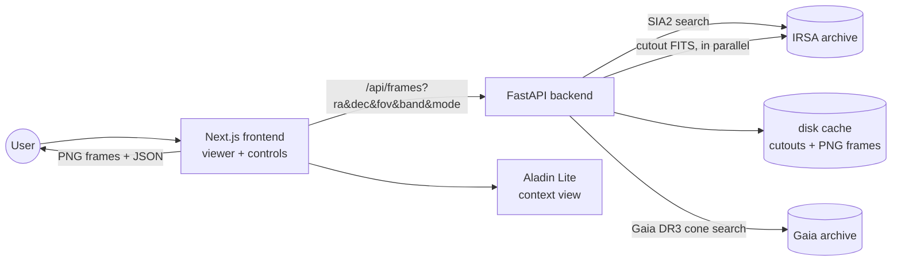

# VERRIER-X — Implementation Plan

**Challenge:** NASA Space Apps 2026, [Planet X and SPHEREx](https://www.spaceappschallenge.org/2026/challenges/planet-x-and-spherex/) (category: Advanced).
**Status:** Draft for approval, written 2026-11-14. No application code exists yet.
**Scope note:** VERRIER-X is separate from the academic `spherex-explorer` project. It shares the verified SPHEREx data facts, but not the code, database design or task list.

**Evidence labels**

| Label | Meaning |
|---|---|
| **[CHALLENGE]** | Stated on the challenge page (read 2026-11-14) |
| **[DATA]** | Verified by opening real SPHEREx Level-2 FITS files |
| **[DOC]** | Verified from IRSA / SPHEREx documentation |
| **[ARCHIVE]** | Verified by a live IRSA query |
| **[INF]** | Inferred, with the reason given |
| **[ASSUME]** | Assumption, not yet checked |

---

## 1. What the challenge asks for

**Required** [CHALLENGE]

1. A **public-facing web tool** that displays SPHEREx images of the sky.
2. The user **enters the coordinates** of a patch of sky (Right Ascension and Declination).
3. The tool shows **a series of images of that patch like a little video**, so that moving objects are easy to spot.
4. Test it on:
   - Barnard's Star
   - Epsilon Indi B
   - WISE 0855 (RA 08h55m10.831s, Dec −7d14m42.53s)
   - RW Aurigae (variable star)
   - R Draconis (variable star)

**Optional considerations** [CHALLENGE], with our priority

| Consideration | Priority | Where |
|---|---|---|
| Easy to update with new data releases | Must | Query the archive live; release name is a config value (§5) |
| Coordinates in the URL, so it can be embedded | Must | `/?ra=…&dec=…&fov=…` (V07) |
| User chooses the field of view | Must | FOV control (V06) |
| Show metadata such as contamination flags | Should | Per-frame info panel (V09) |
| Add together data per detector to improve signal | Should | Stacking per detector and epoch (V10) |
| Add or subtract images from different times | Should | Stack and difference modes (V11) |
| Overlay Gaia / WISE data | Should | Gaia DR3 overlay moved to the frame's date (V12) |
| Generate spectra on the fly | Stretch | Click a source → spectrum (V13) |
| Use Astropy and Aladin | Yes | Astropy in the backend; Aladin Lite for context (V14) |

**Model to follow:** WiseView (`byw.tools/wiseview`), named on the Resources tab [CHALLENGE].

**Not asked for:** automatic detection or tracking, a user database, accounts. People do the spotting; the tool makes it easy. These are out of scope.

---

## 2. Verified facts about the data

### 2.1 The product

| Fact | Evidence |
|---|---|
| Product: Level-2 Spectral Image, one FITS file per detector per exposure, about 70 MB | [DOC][DATA] |
| Layout: `IMAGE`, `FLAGS`, `VARIANCE`, `ZODI`, `PSF`, `WCS-WAVE` | [DATA] |
| `IMAGE` is 2040×2040, unit MJy/sr, about 6.14″ per pixel, about 3.5° across | [DATA] |
| Zodiacal light (`ZODI`) is **not** subtracted from `IMAGE` | [DOC][DATA] |
| Six detectors = six bands: 0.75–1.09, 1.10–1.62, 1.63–2.41, 2.42–3.82, 3.83–4.41, 4.42–5.00 µm | [DOC] |
| **Every pixel has its own wavelength** (linear variable filter). The same star lands on a different wavelength in each exposure. | [DATA][DOC] |
| Stars are about 0.8 pixels wide (undersampled) | [DATA] |
| `FLAGS` is a bitmask. Bit 21 means "known source", not "bad pixel". | [DATA] |
| Time: `DATE-AVG` / `MJD-AVG`, UTC, about 114 s exposures | [DATA] |
| Sky mapping: TAN projection with SIP distortion, ICRS | [DATA] |

### 2.2 Access

| Fact | Evidence |
|---|---|
| Search by position: IRSA SIA2, `https://irsa.ipac.caltech.edu/SIA?COLLECTION=…&POS=circle ra dec r` | [DOC][ARCHIVE] |
| Collections: `spherex_qr2`, `spherex_qr2_deep`, `spherex_qr3`, `spherex_qr3_deep` | [DOC] |
| **Cutout service:** append `?center=ra,dec&size=deg` to a file's access URL. Returns a small FITS with the same layout. | [DOC] — not yet tried by us |
| Files are also mirrored on AWS S3 (`cloud_access` column) | [DOC] |
| New data arrives weekly; SIA2 lags by about a day | [DOC] |
| IRSA returned `502 Proxy Error` on several queries on 2026-11-14 | [ARCHIVE] |
| Required citation: DOI 10.26131/IRSA652 (QR2), 10.26131/IRSA662 (QR3), plus the SPHEREx acknowledgement text | [DOC] |

### 2.3 Coverage of the test targets (0.01° search radius, 2026-11-14)

| Target | `spherex_qr3` | `spherex_qr2` |
|---|---|---|
| Barnard's Star | 124 files, 2026-08-16 → 2026-09-22, all six detectors | 0 files |
| Epsilon Indi B | 120 files, 2026-09-22 → 2026-10-02, detectors 2, 3, 5, 6 | 0 files |
| RW Aurigae | 110 files, 2026-09-02 → 2026-09-16, all six detectors | 0 files |
| WISE 0855 | 0 files (on retry) | 0 files (on retry) |
| R Draconis | query failed (502) | 0 files (on retry) |

Retry notes: a wider search (0.5°) around Barnard's Star in `spherex_qr2` and both deep collections failed with 502 each time, so the 2025 question is still open. The WISE 0855 and R Draconis positions used were approximate catalogue values [ASSUME], so their zero results need re-checking in V01 with exact coordinates. A control field returned 2025 files from `spherex_qr2` and May 2026 files from `spherex_qr3`, so the two collections cover different dates and both must be searched [ARCHIVE].

**Open question (blocks the "motion" demo):** these searches found files from only **one** season per target. Seeing proper motion needs at least two seasons about six months apart. The 2025 passes should exist somewhere (SPHEREx has surveyed since May 2025 [CHALLENGE]), and a different field did return both April–May 2025 and November 2025 files from `spherex_qr2` [ARCHIVE]. Why the targets show none is not yet known. Task V01 resolves this first.

### 2.4 What this means for the design

1. **A plain time-ordered movie will flicker.** Consecutive frames are at different wavelengths, so a star's brightness changes for reasons unrelated to time [DATA]. Frames must be grouped by detector, and each frame labelled with its wavelength.
2. **Motion is small in pixels.** [INF from catalogue proper motions, to be confirmed in V01]

   | Target | Proper motion | Shift in six months |
   |---|---|---|
   | Barnard's Star | about 10.4″/yr | about 5″ ≈ 0.85 px |
   | WISE 0855 | about 8″/yr | about 4″ ≈ 0.65 px |
   | Epsilon Indi B | about 4.7″/yr | about 2.4″ ≈ 0.4 px |

   The display must enlarge and smooth the image, and compare **stacked seasons**, to make a sub-pixel to 2-pixel shift visible.
3. **Stacking is natural here.** One season gives 100+ exposures of a target [ARCHIVE]. Averaging them per detector produces one clean image per season per band. This is also the challenge's own suggestion.
4. **A spectrum comes almost for free.** Each exposure measures the source at a different wavelength, so brightness against wavelength across all frames is the spectrum.
5. **WISE 0855 may be invisible.** It is extremely faint and cold; if it shows at all, it will be in detectors 5–6 (around 4.5 µm) after stacking [INF]. The tool must handle "nothing visible here" gracefully.
6. **Variable stars need same-wavelength comparison.** For RW Aurigae and R Draconis, brightness over time only means something when frames at similar wavelengths are compared [INF].

---

## 3. Product definition

**One-line description:** type a sky position, and watch that patch of sky across time in SPHEREx's six infrared bands.

**Main screen**

- **Search bar:** RA/Dec in degrees or sexagesimal, or an object name. Quick buttons for the five test targets.
- **Viewer:** the blink movie. Play/pause, speed, step frame by frame, crosshair at the searched position, scale bar, north up.
- **Controls:**
  - Field of view (default 10′)
  - Detector (band) selector
  - Mode: *Seasons* (stacked, default) / *All exposures* / *Difference*
  - Stretch (how brightness maps to grey levels)
  - Overlays: Gaia, flagged pixels
- **Frame info:** date, detector, wavelength at the centre, number of exposures in the stack, flag summary, link to the source file.
- **Context panel:** Aladin Lite showing the same field in another survey.
- **Spectrum panel** (stretch): brightness against wavelength for the clicked source.

**Language rule:** the tool never says "discovery". It shows images; the user draws conclusions.

---

## 4. Architecture



| Part | Choice | Reason |
|---|---|---|
| Frontend | Next.js + TypeScript + Tailwind; Canvas for the viewer | URL parameters and deployment are simple; Canvas gives exact control of blink timing and overlays |
| Backend | Python + FastAPI | FITS, WCS and reprojection need Astropy |
| Science libraries | astropy, numpy, pyvo, reproject, astroquery (Gaia) | All verified to work with this data, except reproject (not yet installed anywhere) |
| Storage | Disk cache keyed by (file, centre, size). **No database.** | Nothing needs relational storage; a cache makes repeat views instant |
| Hosting | Decision D2 | "Public-facing" needs a public URL |

**Backend pipeline for one request**

1. **Search:** SIA2 for all exposures covering the position, across the configured collections.
2. **Fetch:** download cutouts in parallel (limited concurrency, retries); skip any already cached.
3. **Prepare each cutout:** subtract `ZODI`, subtract the remaining median background, mask bad pixels by flag bits.
4. **Align:** reproject onto one common north-up grid centred on the requested position.
5. **Group:** by detector and by season (a gap of more than 30 days starts a new season).
6. **Stack** (Seasons mode): sigma-clipped mean per group.
7. **Render:** PNG per frame with a shared stretch per detector, so brightness is comparable between frames.
8. **Return:** JSON listing the frames with their metadata and image URLs.

**API (draft)**

| Route | Returns |
|---|---|
| `GET /api/resolve?name=` | RA/Dec for an object name |
| `GET /api/frames?ra=&dec=&fov=&band=&mode=` | Frame list: `{time, detector, wavelength_um, n_exposures, flags, png_url, source_urls}` |
| `GET /api/frame/{id}.png` | One rendered frame |
| `GET /api/spectrum?ra=&dec=` | Points of `{wavelength_um, flux, flux_err, time}` |
| `GET /api/gaia?ra=&dec=&fov=&epoch=` | Gaia sources moved to the given date |
| `GET /api/health` | Status |

Long requests stream progress ("fetched 37 of 124 cutouts") so the page never looks frozen.

---

## 5. Repository layout (proposed)

```
VERRIER-X/
├── IMPLEMENTATION_PLAN.md      this file
├── README.md
├── .gitignore                  ignores data, caches, .env, node_modules
├── backend/
│   ├── pyproject.toml          Python 3.12, managed with uv
│   ├── app/
│   │   ├── main.py             FastAPI app
│   │   ├── config.py           collections, cache dir, limits
│   │   ├── archive.py          SIA2 search + cutout download
│   │   ├── prepare.py          background, masks
│   │   ├── align.py            common grid, reprojection
│   │   ├── stack.py            grouping and stacking
│   │   ├── render.py           stretch + PNG
│   │   ├── spectrum.py         forced photometry per exposure
│   │   └── overlays.py         Gaia query + proper-motion shift
│   └── tests/
├── frontend/
│   ├── app/page.tsx            search + viewer
│   ├── components/             Viewer, Controls, FrameInfo, SpectrumPlot, AladinPanel
│   └── lib/api.ts
└── docs/
    ├── data-notes.md           §2 of this plan, kept current
    └── demo-script.md
```

A new data release is added by editing one list in `config.py`.

---

## 6. Tasks

Each task lists what to do and how to know it is done. **M** = must have, **S** = should have, **X** = stretch.

### Phase A — Prove the data path (do first; everything depends on it)

| ID | Pri | Task | Done when |
|---|---|---|---|
| V01 | M | **Coverage spike.** For all five targets, list every exposure in all four collections with a wider radius; retry on 502. Find where the 2025 passes are. | A table of seasons per target per detector exists in `docs/data-notes.md`, and we know whether two seasons are available for each target |
| V02 | M | **Cutout spike.** Download one cutout via `?center=&size=`; confirm layout, WCS and size; time it. Try the S3 route for comparison. | Measured seconds per cutout and bytes per cutout are written down; fetch route chosen |
| V03 | M | **Environment.** Python 3.12 via uv, dependencies locked, one smoke test. | `uv sync && uv run pytest` passes on a clean clone |

### Phase B — Minimum working tool

| ID | Pri | Task | Done when |
|---|---|---|---|
| V04 | M | `archive.py`: search + parallel cached cutout download with retry | Second run of the same request downloads nothing |
| V05 | M | `prepare.py` + `align.py` + `render.py`: background removal, masks, common grid, PNG | A known star sits on the same pixel in every frame (within 0.5 px) |
| V06 | M | `/api/frames` in *All exposures* mode, with FOV parameter | Returns frames for Barnard's Star in under an agreed time (set after V02) |
| V07 | M | Frontend: search, blink viewer, play controls, URL parameters | Opening `/?ra=269.45&dec=4.77&fov=10` plays the movie without clicks |
| V08 | M | Detector selector and per-frame labels (date, wavelength) | Switching detector changes the frame set; every frame shows its wavelength |

### Phase C — Make motion visible

| ID | Pri | Task | Done when |
|---|---|---|---|
| V10 | S | `stack.py`: stack per detector per season; *Seasons* mode becomes the default | Barnard's Star visibly shifts between season frames while field stars stay still (needs two seasons from V01) |
| V11 | S | *Difference* mode: season B − season A, same detector | A moving star shows as a dark/bright pair; still stars mostly cancel |
| V09 | S | Frame info panel with flag summary and source links | Flag names match the `MP_*` keywords in the file |
| V12 | S | Gaia DR3 overlay, positions moved to each frame's date using proper motion | Barnard's Star marker tracks the star across seasons |

### Phase D — Stretch and polish

| ID | Pri | Task | Done when |
|---|---|---|---|
| V13 | X | Spectrum on the fly: forced photometry on each exposure at the clicked position | A smooth spectrum appears for a bright star; error bars shown |
| V14 | X | Aladin Lite context panel, linked to the same centre and FOV | Panel follows a new search |
| V15 | S | Object-name search and quick-pick buttons for the five targets | All five load from one click |
| V16 | M | Loading, empty and error states (no coverage; archive down; faint target) | Each state has a clear message; archive failure offers retry |

### Phase E — Ship

| ID | Pri | Task | Done when |
|---|---|---|---|
| V17 | M | Deploy frontend and backend to public URLs | A phone on mobile data can load a target |
| V18 | M | Pre-warm the cache for the five test targets | Each loads in a few seconds on the public site |
| V19 | M | Test notes for all five targets: what is visible, what is not, and why | `docs/demo-script.md` has one honest paragraph per target |
| V20 | M | README, data credits (DOIs + acknowledgement), submission materials | Everything the Space Apps submission form asks for is ready (D1) |

**Order:** V01 → V02 → V03 → V04 → V05 → V06 → V07 → V08 → V16 → V17 → V18, then V10, V11, V12, V09, V15, then V13, V14, then V19, V20.
**Parallel split:** once the `/api/frames` JSON shape is agreed (after V02), one person builds the backend (V04–V06, V10–V13) and the other the frontend against sample JSON (V07–V09, V14–V16).

---

## 7. Tests

| Kind | What |
|---|---|
| Unit | Coordinate parsing (degrees and sexagesimal); season grouping; stretch is deterministic; cache key |
| Science | Alignment: a synthetic star placed by sky position lands on the same output pixel from two different input grids. Stacking: mean of N noisy frames has noise ≈ σ/√N. Gaia shift: Barnard's Star moves by its catalogue proper motion per year. |
| Integration | `/api/frames` against recorded archive responses (no network needed) |
| End to end | The five target URLs load and play on the deployed site |

---

## 8. Risks

| # | Risk | Fallback |
|---|---|---|
| 1 | Only one season per target is reachable, so no motion can be shown | Show within-season movies and spectra; demonstrate motion on a field that does have two seasons; say so plainly |
| 2 | IRSA is slow or returns 502 during judging | Disk cache, pre-warmed for the test targets; retries with backoff |
| 3 | Shifts under one pixel are hard to see | Stacked seasons, enlarged display, difference mode, Gaia marker as a guide |
| 4 | WISE 0855 is not visible | Report it as a limit of the data, with the stacked detector-5/6 image as evidence |
| 5 | Cutout downloads are too slow for 100+ frames | Cap exposures per request; stack on the server; try S3; stream progress |
| 6 | Free hosting sleeps or lacks memory for Astropy | Choose hosting after measuring memory in V02 |
| 7 | Too many features for the time available | Phases B and E first; C and D only after the tool is live |

---

## 9. Decisions (made 2026-11-14)

| ID | Decision |
|---|---|
| D1 | **Deadline: 15 November 2026, 11:59 pm.** The demo is a slide deck of **at most 7 slides** (see §10). |
| D2 | Frontend on Vercel (account exists). Backend on a small container host, chosen after V02 measures memory use. |
| D3 | Two people. Luvya builds the frontend and backend. Sainy is the validation and submission lead (below). |
| D4 | The GitHub repository is public. |

### Cut line for the deadline

With about a day and a half, the order is strict:

1. **Must ship:** V01–V08, V16, V17, V18, V19, V20 and the 7 slides.
2. **Only if the tool is live by midday on 15 November:** V10 (season stacking), then V12 (Gaia overlay), then V11 (difference).
3. **Likely dropped:** V13 (spectra), V14 (Aladin panel), V09, V15.

Slides and submission start no later than 6 pm on 15 November, whatever state the features are in.

### Teammate task: validation and submission lead (Sainy, `Sainyy56`)

She owns the proof that the tool works and the way it is presented to the judges. This covers the Validity and Presentation judging criteria, and the challenge's "test your tool on" requirement. It needs no backend or frontend code.

**Part 1 — Target fact sheet (start now; V01 is waiting on it)**

For each of the five test targets, record in `docs/targets.md`:

1. Exact coordinates (J2000) and the catalogue they come from.
2. Proper motion (″/yr) and parallax.
3. Brightness in the near-infrared (J, H, K; W1, W2 where known).
4. **Predicted shift between SPHEREx seasons**, in arcseconds and in pixels (1 pixel = 6.14″). For example, Barnard's Star at about 10.4″/yr moves about 5.2″ ≈ 0.85 px in six months.
5. For the two variable stars: period and brightness range.
6. One sentence on what a viewer should expect: moves, varies, or may be too faint.

**Part 2 — Validation record (once the tool is live; V19)**

1. Open each target in the tool and take a screenshot.
2. Compare what is seen with the Part 1 prediction: did it move by about the predicted amount, in the predicted direction?
3. Write one honest paragraph per target in `docs/demo-script.md`, including targets where nothing is visible and why.
4. Report anything that looks wrong (misaligned frames, wrong labels) as a GitHub issue.

**Part 3 — Submission (V20)**

1. Lead the slide deck, at most 7 slides, following the checklist in §10.
2. Draft the project page text: high-level summary, detailed description, NASA data, partner data and references.
3. Test every link in a private browser window before submitting.

Luvya supplies the screenshots of features and the technical description; Sainy owns the story and the evidence.

## 10. Submission checklist

Source: [Project Submission Guide](https://www.spaceappschallenge.org/resources/project-submission-guide/), read 2026-11-14.

**Deadline:** click **"Submit for Judging"** before Sunday 15 November, 11:59 pm, local time of the team's Local Event (for the Universal Event, the Team Owner's local time). Anything saved after that is not judged. Resubmitting before the deadline is allowed; the last saved version counts.

**Eligibility**

- [ ] All team members are confirmed participants at the **same Local Event**.
- [ ] Every required form field is filled, in English.
- [ ] Nothing shows the likeness of anyone under 18.

**Project form fields**

- [ ] Project Name
- [ ] High-Level Project Summary (what it is, how it addresses the challenge, why it matters)
- [ ] Link to Project Demo
- [ ] Link to Final Project (the live site or the GitHub repository)
- [ ] Detailed Project Description (what it does, how it works, tools and languages)
- [ ] Use of AI tools (the form calls this "Super Intelligence (SI)")
- [ ] NASA Data (at least one NASA source is required for Global Awards: SPHEREx via IRSA)
- [ ] Space Agency Partner Data and Other References (every dataset, tool, library and image used)

**Demo**

- [ ] Slide deck of **at most 7 slides, including the title and intro slides**, or a video of at most 30 seconds. Going over makes the project ineligible for Global Judging.
- [ ] Slides state the team name, the members' names and the challenge chosen.
- [ ] Slides show an image of the project, describe the user experience, and say how NASA and partner data make it possible.
- [ ] Hosted externally (Google Drive, GitHub, etc.) with a public link that needs no login. Test it in a private browser window.

**Links must work for judges**

- [ ] Live site and repository open without any login.
- [ ] Optional but recommended for a new website: request a FortiGuard Web Filter Classification so judges' networks don't block it.

**AI disclosure**

- [ ] The form answer says where and how AI tools were used.
- [ ] AI-generated code is acknowledged in descriptive text and metadata (README note and commit trailers).
- [ ] Any AI-generated image or video carries a visible watermark.
- [ ] No AI-generated content uses NASA logos or mission identifiers.
- The guide says AI should not be used to come up with the idea for solving the challenge.

**Judging criteria:** Impact, Creativity, Validity, Relevance, Presentation. Most of the score comes from the project page itself; the demo mainly affects Presentation.

**Partner data:** using Space Agency Partner data is encouraged. ESA is a partner, so the Gaia overlay (V12) counts; the challenge page also lists CSA's NEOSSat data.

## 11. First task after approval

**V01 + V02 (data spikes).** Two short scripts, no application code. They answer the two questions the whole design rests on: are two seasons of data reachable for the test targets, and how fast is a cutout.
